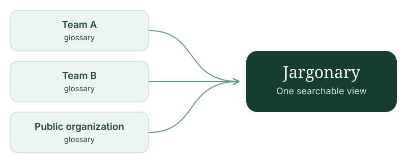

# Jargonary



Jargonary is a distributed glossary: teams publish their vocabulary as JSON or YAML, and Jargonary combines it into one searchable UI. Identical terms can have different meanings across teams; source identities stay separate.

A standalone Go binary or container bundles the UI and SQLite cache. Source systems handle editing and approval; your proxy handles TLS and user authentication.

## Try it

```sh
docker compose up --build
```

Open [localhost:8080](http://localhost:8080/) and search for **API** to compare the sample teams' definitions.

Or download a [release binary](https://github.com/alampros/jargonary/releases):

```sh
./jargonary -config examples/config.yaml
```

Or serve one glossary directly:

```sh
./jargonary -f ./glossary.yaml
```

Use stdin for CI checks or to preview a glossary without saving a temporary file:

```sh
# CI: validate YAML and exit with a nonzero status if invalid.
./jargonary -validate - -format yaml < terms/payments.yaml

# Preview JSON produced by your own exporter or generation script.
./scripts/generate-glossary | ./jargonary -f -

# Browse a snapshot of a published glossary in the local web UI.
curl -fsS https://glossary.example.com/.well-known/glossary/partners | ./jargonary -f -
```

Replace the script and URL with your own. JSON is the default; use `-format yaml` for YAML. Serving waits for EOF, validates the input, and serves one snapshot until stopped. In Bash or Zsh, use `set -o pipefail` to also fail a pipeline when its generator or download fails. See [stdin details and Docker usage](docs/sources.md#read-from-stdin).

On macOS, install the bundled binary with Homebrew:

```sh
brew install --cask alampros/tap/jargonary
```

The cask includes the web UI. `go install` is unsupported because it omits the frontend assets. For source builds, use [the development tasks](docs/development.md).

## Connect your glossaries

```yaml
sources:
  - id: payments
    file: terms/payments.yaml
  - id: platform
    url: https://platform.internal/.well-known/glossary
```

Sources are polled; failed fetches retain the last accepted content. `/.well-known/glossary` is a proposed convention, not a registered standard or automatic network discovery.

See the [format guide](docs/dictionary-format.md), [schema](docs-site/public/schema/v0.4.1/glossary.schema.json), and [examples](examples/terms/). Named [exports](docs/publishing.md) share selected content; read-only [MCP](docs/mcp.md) tools expose it to AI clients.

To generate a glossary from your project's documentation and code, point your LLM to the [glossary generation skill](skills/generate-jargonary-glossary/SKILL.md).

[Documentation](https://alampros.github.io/jargonary/) covers [deployment](docs/reference.md), [branding](docs/customization.md), and [development](docs/development.md).

## Develop

Requires Go 1.27 and Node 26:

```sh
go tool task dev
go tool task check
```

MIT licensed.
